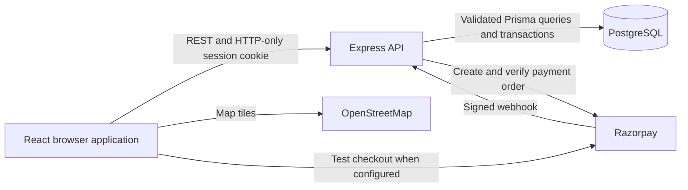

# Architecture

Vite serves the frontend during development and forwards API requests to Express. In a same-origin production deployment, Express serves the built frontend and REST routes together. The UI gets session state from the API and uses route guards for navigation. Every protected backend action independently verifies the session, enforces its role requirement and checks access to the relevant resource.

## Marketplace flow

The public catalog exposes approved listings. A charging host creates a draft, enters charger specifications and availability, declares required safety information, then submits the station for review. An administrator decides whether to approve or reject it. Station and identity statuses have different meanings. A listing decision does not imply verified Aadhaar identity.

The API applies the station schedule and date blocks in Asia/Kolkata. A reservation fixes the agreed price and fee in integer paise, checks the current schedule on the server and acquires an available slot in PostgreSQL. Database constraints protect active slots from overlap. A pending payment holds the slot temporarily. Cancellation and expiration release it.

An eligible reservation can become confirmed after backend-authorized checkout. The host can start and complete the session according to the state rules. Estimated and actual energy appear as separate values. The booking history connects each owner to their reservation and keeps their review eligibility.

## Data and trust boundaries

- Browsers send estimated energy, dates and actions. The API supplies prices, identity and permissions.
- Session cookies are HTTP-only. Passwords are hashed. Sensitive configuration stays in server environment variables.
- Razorpay verification uses server secrets. Development-only test flows are labeled in the UI. No card data is handled by PlugLink.
- OpenStreetMap tiles and route links are external services. Geolocation is optional. Samples use approximate areas and fictional addresses.
- Private compliance information and complete account details stay within authenticated, authorized routes.
